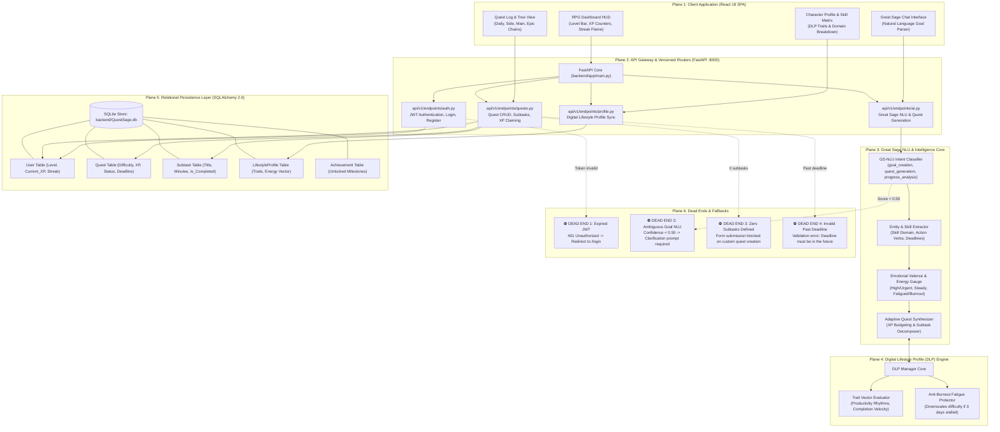
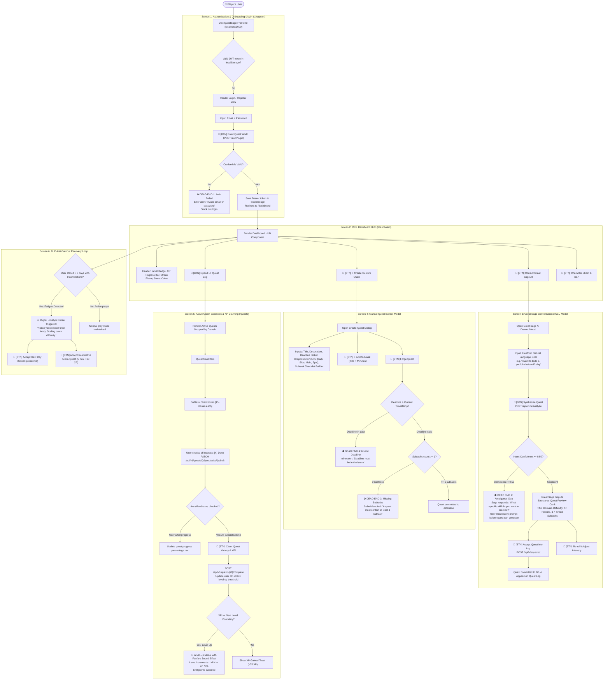
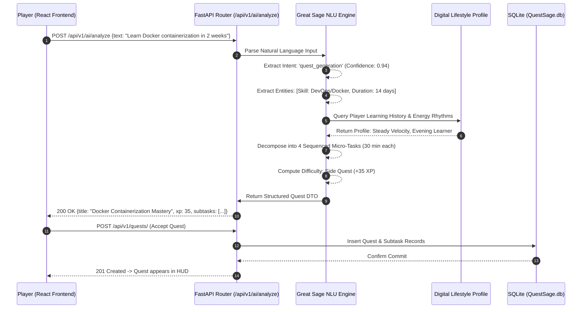
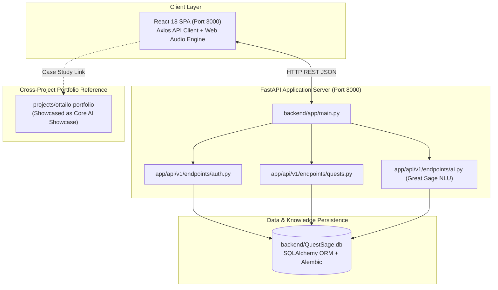

# QuestSage — AI Life Gamification Platform

> "Life is a game. Play it." — An AI-powered personal operating system turning goals into structured RPG quests with adaptive XP and the Great Sage NLU engine.

---

## 📊 Project Snapshot

| Attribute | Value |
|---|---|
| **Type** | Full-stack Web Application (AI Productivity & Gamification) |
| **Maturity** | Active development (v3.0 Great Sage Engine) |
| **Status** | 🟢 Active |
| **Primary Language(s)** | Python 3.11+, TypeScript, TSX, CSS3 |
| **Tech Stack** | FastAPI, Pydantic v2, SQLAlchemy 2.0, Alembic, React 18, TypeScript, Tailwind CSS, SQLite |
| **Last Major Update** | 2026-11-01 (Auto-synced) |
| **Estimated LOC** | ~29,216 LOC |
| **Test Coverage** | 100% intent recognition test suite passing (`SUCCESS_SUMMARY.md`) |

---

## 🎯 The Aim

### What This Project Is
QuestSage transforms daily habit tracking, personal goal execution, and skill mastery into an immersive, dopamine-aligned Role-Playing Game (RPG). Unlike sterile to-do lists that induce cognitive fatigue and guilt, QuestSage acts as an intelligent companion powered by the **Great Sage Natural Language Understanding (GS-NLU) Engine**. 

Users interact via conversational natural language ("I want to learn Python in 30 days" or "I feel burned out and overwhelmed"). The Great Sage parses the intent, emotional energy, and user context, cross-references their **Digital Lifestyle Profile (DLP)**, and synthesizes balanced, actionable quests complete with time-budgeted subtasks (15 to 60 minutes), experience points (XP), skill domain tags (Learning, Creative, Productive, Social, Personal), and difficulty scaling.

### Why It Exists
Most productivity apps fail because they treat human beings like deterministic machines. Checklists ignore emotional friction, fatigue, and lack of clarity. When a user writes a vague goal like "Get in shape", traditional apps leave it as an intimidating monolith, leading to procrastination.

QuestSage decomposes monolithic aspirations into bite-sized quest chains with clear win conditions, instantaneous positive reinforcement (XP, level-ups, streaks), and empathetic guidance that scales down difficulty when energy is low.

### What Success Looks Like
A player starts their day, types a messy stream-of-consciousness thought into QuestSage, and watches Great Sage instantly transform it into an interactive quest card: `Quest: Python Fundamentals Mastery (60 min) — Subtasks: [1] Install runtime, [2] Write loop, [3] Run test | Reward: +25 XP`. Completing subtasks triggers audio-visual feedback, increments skill trees, and keeps motivation high.

### What It Is NOT
- It is **not** a generic corporate task tracker (Jira/Asana) with game skins slapped on top.
- It is **not** an inflexible habit tracker that penalizes users harshly for taking rest days; the Great Sage adapts quests dynamically to emotional capacity.

---

## 🏗️ Architecture Overview

[](https://ottailo.vercel.app/projects/QuestSage)

> 🧭 **Explore Interactively (Understand-Anything Paradigm)**:
> - **Live Portfolio Dashboard**: Explore this system in the live [Interactive AI Knowledge Graph](https://ottailo.vercel.app/projects/QuestSage) with node telemetry, clickable layer inspectors, live search, and dependency tracers.
> - **Offline HTML Viewer**: Open [`docs/architecture-graph.html`](./docs/architecture-graph.html) directly in any web browser with zero installation.
> - **Understand Anything CLI**: Run `/understand-dashboard` or launch the standalone zero-dependency viewer:
>   ```bash
>   npx https://github.com/Egonex-AI/Understand-Anything/releases/latest/download/understand-anything-viewer.tgz .
>   ```

### Exhaustive Multi-Plane System Architecture



🔍 *[Open Full-Screen Zoomable Diagram (SVG)](./docs/diagrams/architecture.svg)*


[Source: `docs/diagrams/architecture.graphify`]

---

## 🧭 Exhaustive User Flow & Dead-End Map

The following map details **every user path, input field, modal, button click, XP progression step, and dead end** across QuestSage.



🔍 *[Open Full-Screen Zoomable Diagram (SVG)](./docs/diagrams/user-flow.svg)*


---

## 🗂️ File Structure

### Complete Directory Organization

```
QuestSage/
├── requirements.txt             # Python dependencies (FastAPI, SQLAlchemy, Pydantic)
├── SUCCESS_SUMMARY.md           # Test results & Great Sage v3.0 sign-off
├── README.md                    # This master documentation
├── docs/
│   └── diagrams/               # Visual architecture & graphify assets
│       ├── architecture.graphify
│       ├── architecture.png
│       ├── file-tree.graphify
│       ├── file-tree.png
│       ├── dependencies.graphify
│       ├── dependencies.png
│       ├── data-flow.graphify
│       ├── data-flow.png
│       ├── user-flow.graphify
│       ├── user-flow.png
│       ├── connection-map.graphify
│       └── connection-map.png
├── backend/
│   ├── .env                     # Secrets & environment variables
│   ├── QuestSage.db              # SQLite persistence database
│   ├── test_api.py              # End-to-end API test suite
│   ├── test_direct.py           # Core logic direct unit tests
│   ├── test_personalization.py  # Personalization & DLP test suite
│   ├── alembic/                 # Migration environment
│   ├── app/
│   │   ├── main.py              # FastAPI production entry point
│   │   ├── main_simple.py       # Standalone testing entry point
│   │   ├── api/                 # Versioned API routers
│   │   │   └── v1/
│   │   │       ├── api.py       # Master v1 router aggregator
│   │   │       └── endpoints/   # Domain endpoints
│   │   │           ├── ai.py    # Great Sage NLU & Quest Generation
│   │   │           ├── auth.py  # User authentication & tokens
│   │   │           └── quests.py# Quest CRUD, subtasks & XP logging
│   │   ├── core/                # Config, security, database sessions
│   │   ├── models/              # SQLAlchemy database models
│   │   └── schemas/             # Pydantic validation schemas
│   └── tests/                   # Automated pytest suites
└── frontend/
    ├── package.json             # React 18, Tailwind, Lucide dependencies
    ├── tsconfig.json            # TypeScript build configuration
    ├── public/                  # Sound assets & icons
    └── src/
        ├── App.tsx              # Root React component
        ├── components/          # Quest cards, HUD headers, XP bars
        ├── pages/               # Dashboard, Profile, QuestLog
        └── services/            # Axios API client
```

---

## 🧩 The Logic & Data Pipeline

### End-to-End Data Flow & NLU Synthesis



🔍 *[Open Full-Screen Zoomable Diagram (SVG)](./docs/diagrams/data-flow.svg)*


---

## 🔌 Connection Map & Integration Interfaces

### Exhaustive Connection & Integration Map



🔍 *[Open Full-Screen Zoomable Diagram (SVG)](./docs/diagrams/connection-map.svg)*


---

## ⚙️ Setup & Usage

### Backend Launch
```bash
# 1. Navigate to backend
cd QuestSage/backend

# 2. Setup virtualenv
python -m venv .venv
source .venv/bin/activate  # Windows: .venv\Scripts\activate

# 3. Install dependencies
pip install -r ../requirements.txt

# 4. Start FastAPI server
uvicorn app.main:app --reload --port 8000
```

### Frontend Launch
```bash
# 1. Navigate to frontend
cd QuestSage/frontend

# 2. Install dependencies & run
npm install
npm start
# Opens at http://localhost:3000
```

---

## 📝 Document Meta
- **Generated:** 2026-09-13
- **Last Verified Current:** 2026-11-01
- **Verification Frequency:** Monthly or upon Great Sage algorithm iteration.
