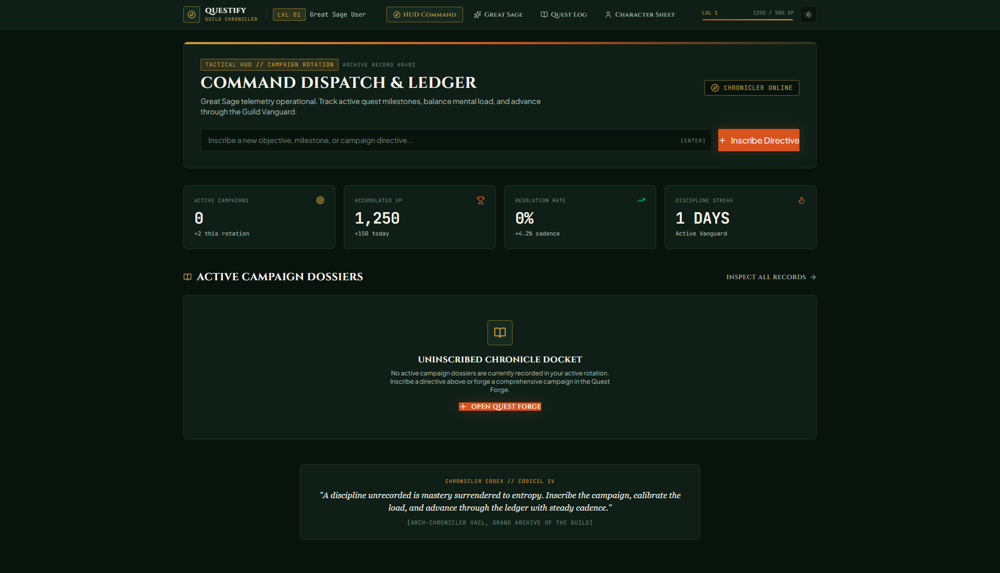

# Questify

Questify is a goal tracker that turns a goal into a small set of weighted steps, then records progress and XP in a local database. The React app has a dashboard, goal list, planner chat, and profile; a FastAPI service provides the JSON API and can ask a configured OmniRoute gateway for a goal breakdown. The checked-in code supports the main create, edit, delete, subtask, and completion flows, but some authentication, AI, test, and profile claims need care. This README describes the repository as it exists, not every claim in its older documentation.

## The problem it solves

A broad goal such as “learn Python” is hard to start when it has no clear next action. Questify stores goals as quests, breaks their progress into weighted subtasks, and shows completed steps and XP in a single interface. The planner chat can request a structured quest suggestion, which the user can save to the quest list.

## What works in the checked-in code

- The frontend routes to a dashboard, planner chat, quest list, profile, login, and registration pages (`frontend/src/App.tsx`).
- The quest list can create, edit, delete, search, and filter quests. It can toggle weighted subtasks and request quest completion (`frontend/src/pages/QuestList.tsx`).
- The dashboard can create a goal with three default steps and display recent quests and user statistics (`frontend/src/pages/Dashboard.tsx`).
- The planner requests an analysis from `POST /api/v1/ai/analyze`, displays a returned quest blueprint, and can save it as a quest (`frontend/src/pages/QuestChat.tsx`). The backend calls OmniRoute for AI requests and has a template fallback in `backend/app/services/ai/omniroute_client.py`.
- Registration and login handlers hash passwords with bcrypt and issue JWTs (`backend/app/api/v1/endpoints/auth.py`, `backend/app/core/security.py`).
- SQLite is the default database. The SQLAlchemy models also include PostgreSQL-compatible settings (`backend/app/core/config.py`, `backend/app/core/database.py`).

These are code-level findings. The app and test suite were not run for this README draft.



## Architecture

The frontend sends JSON requests to the FastAPI service. Quest records and user records use SQLAlchemy. The AI endpoints call OmniRoute through the backend client, with local fallback responses when that call fails.

```text
Questify/
├── README.md
├── requirements.txt
├── backend/
│   ├── app/
│   │   ├── main.py
│   │   ├── api/v1/
│   │   │   ├── api.py
│   │   │   └── endpoints/
│   │   │       ├── ai.py
│   │   │       ├── auth.py
│   │   │       ├── quests.py
│   │   │       └── users.py
│   │   ├── core/
│   │   │   ├── config.py
│   │   │   ├── database.py
│   │   │   ├── deps.py
│   │   │   └── security.py
│   │   ├── models/
│   │   │   ├── achievement.py
│   │   │   ├── quest.py
│   │   │   └── user.py
│   │   ├── schemas/
│   │   ├── services/ai/
│   │   │   ├── gs_nlu_engine.py
│   │   │   ├── omniroute_client.py
│   │   │   └── quest_generator.py
│   │   └── tests/test_backend_api.py
│   ├── test_api.py
│   ├── test_direct.py
│   ├── test_direct_personalization.py
│   └── test_personalization.py
├── docs/
│   ├── architecture-graph.html
│   └── diagrams/
├── frontend/
│   ├── package.json
│   └── src/
│       ├── App.tsx
│       ├── components/
│       ├── pages/
│       ├── services/api.ts
│       └── styles/questify-design-system.css
├── scripts/
│   ├── check_styles.mjs
│   ├── dev.ps1
│   └── run_e2e_suite.mjs
└── tests/screenshots/
```

The tree shows representative files, not every file in the repository. Quest subtasks are stored as JSON on the quest record; they are not a separate SQL table.

## Tech stack

| Area | Tools in the repository |
|---|---|
| API | Python, FastAPI, Uvicorn, Pydantic v2 |
| Persistence | SQLAlchemy 2, SQLite by default, optional PostgreSQL configuration |
| Authentication | bcrypt, JWT signing and validation code |
| AI requests | `httpx` client for an OpenAI-style OmniRoute chat-completions endpoint |
| Web app | React 19, TypeScript, Create React App (`react-scripts`), React Router 7 |
| Client data | Axios and TanStack React Query |
| UI | Tailwind CSS 3, Lucide React, `canvas-confetti`, project CSS variables |
| Tests | pytest and React Testing Library/Jest through `react-scripts test` |

Python dependencies are pinned in `requirements.txt`. Frontend dependencies and their lockfile are in `frontend/package.json` and `frontend/package-lock.json`.

## Quickstart

Use Python 3.11 or newer and Node.js/npm. These commands install the checked-in dependencies and start the API and web app separately.

Terminal 1, from the repository root:

```bash
cd backend
python -m venv .venv
# Windows PowerShell:
.venv\Scripts\Activate.ps1
# macOS/Linux:
# source .venv/bin/activate
pip install -r ../requirements.txt
uvicorn app.main:app --reload --port 8000
```

Terminal 2, from the repository root:

```bash
cd frontend
npm ci
npm start
```

The frontend runs at `http://localhost:3000`; the API runs at `http://127.0.0.1:8000`. The frontend package proxy points to port 8000. The API creates its tables when its lifespan starts. Set `QUESTSAGE_SECRET_KEY`, `OMNIROUTE_URL`, `OMNIROUTE_API_KEY`, and `OMNIROUTE_MODEL` in the API process environment. See `.env.example`. Do not commit a real `.env` file or paste a live key into source code.

## Usage

Open the dashboard to add a goal, or go to the planner chat to ask for a breakdown. In the goal list, create or edit a quest, toggle its weighted steps, and use the completion action to request XP. Profile data and the planner depend on the API being available.

The API can also be checked directly:

```bash
curl http://127.0.0.1:8000/health

curl --request POST http://127.0.0.1:8000/api/v1/quests/ \
  --header "Content-Type: application/json" \
  --data '{"title":"Prepare a project outline","description":"Write and review the first outline.","quest_type":"side","difficulty":"normal","xp_value":150,"estimated_duration":30,"subtasks":[{"text":"List the sections","completed":false,"weight":40},{"text":"Draft the outline","completed":false,"weight":60}]}'
```

The second request creates a record in the configured database. Several quest and user endpoints accept requests without a bearer token, so do not expose this API as a multi-user service in its current configuration.

## API surface

All versioned endpoints are mounted under `/api/v1`. FastAPI's interactive documentation is at `/docs` while the service is running.

| Method | Path | Purpose |
|---|---|---|
| `GET` | `/health` | Basic health response |
| `POST` | `/auth/register` | Register a user and return a token |
| `POST` | `/auth/login` | Authenticate and return a token |
| `GET` | `/auth/me` | Read the authenticated account profile |
| `GET` | `/users/profile`, `/users/stats`, `/users/achievements`, `/users/activity` | Read profile and summary data |
| `GET`, `PUT` | `/users/{user_id}/dlp` | Read or update the Digital Lifestyle Profile |
| `GET` | `/quests/`, `/quests/recent` | List quests |
| `POST` | `/quests/` | Create a quest |
| `PUT`, `DELETE` | `/quests/{quest_id}` | Update or delete a quest |
| `PATCH` | `/quests/{quest_id}/subtasks/{subtask_id}/toggle` | Toggle a subtask and recalculate weighted progress |
| `POST` | `/quests/{quest_id}/complete` | Mark a quest complete and award XP |
| `POST` | `/ai/analyze`, `/ai/generate-quest` | Analyze a message or request a quest blueprint |
| `GET` | `/ai/performance` | Return AI service metadata |

`/users/{user_id}/stats` is also available. The route definitions are in `backend/app/api/v1/endpoints/`. The `/ai/performance` handler references `settings` without importing it in `ai.py`, so that route is not verified and is expected to fail until corrected.

## Data model

The SQLAlchemy model files define:

- `User` records with account fields, XP, level, streak, and JSON profile data (`backend/app/models/user.py`).
- `DigitalLifestyleProfile` records with preference, energy, interest, and learning-style fields.
- `Quest` records with type, difficulty, status, XP, duration, progress, timestamps, feedback, and JSON subtasks (`backend/app/models/quest.py`).
- `QuestTemplate` and `QuestSequence` records for template and grouped-goal data.
- Achievement, user-achievement, skill, wisdom-point, and user-level records (`backend/app/models/achievement.py`).

At startup, `Base.metadata.create_all()` creates tables directly. There is no checked-in Alembic migration directory in this checkout. The `/users/achievements` endpoint currently calculates four achievement results from counts and XP; it does not load the achievement-definition tables.

## Tests and checks

The repository contains a backend integration test at `backend/tests/test_backend_api.py`, several direct or server-based scripts under `backend/`, and one frontend test at `frontend/src/App.test.tsx`.

Commands declared or supported by the repository include:

```bash
cd backend
python -m pytest -q tests/test_backend_api.py

cd ../frontend
npm test -- --watchAll=false
npm run build
```

No tests or builds were run while preparing this draft. The frontend test is still the Create React App starter assertion for a “learn react” link, while the current `App.tsx` renders Questify routes. Treat that test as stale, not as evidence that the current UI passes. The backend integration test covers a health response, authentication, quest creation, subtask progress, and XP completion, but it does not test the AI flow. Run it only against a disposable database. `scripts/run_e2e_suite.mjs` starts services and captures browser screenshots, but it points to machine-specific Puppeteer and Edge paths and is not a portable CI command.

The repository has screenshots under `tests/screenshots/`. They document captured UI states; their presence does not prove that the current checkout passes an end-to-end run.

## Deployment

No Dockerfile or checked-in deployment configuration is present at the repository root. `frontend/vercel.json` exists, but a deployment target and current hosted behavior were not verified for this draft. A deployment needs a configured API URL, an explicit CORS allowlist, a non-default JWT signing key, a persistent database, and an AI gateway configuration if AI generation is required. The API currently allows optional authentication and falls back to user ID `1` in several routes. Resolve that data-isolation behavior before serving multiple users.

## Design decisions

- A quest stores subtasks as JSON, so the current progress operation updates one quest record rather than maintaining a separate subtask table.
- Subtask weights drive the progress percentage returned by the API.
- SQLite is the out-of-box database; configuration can select a PostgreSQL URL.
- The planner calls an OpenAI-style chat-completions API through the configured OmniRoute gateway. The client includes template fallbacks when the gateway is unavailable.
- React Query manages server data; the app's visual system lives in its CSS and Tailwind files.

## Limitations and unverified claims

- The routes in `App.tsx` are described as protected in a comment, but the route tree does not add an authentication guard. The layout also does not redirect unauthenticated users.
- Several frontend calls hard-code user ID `1`. Quest and profile routes also permit optional authentication or select a fallback account. The current wiring does not establish safe per-user isolation.
- `frontend/src/pages/Login.tsx` preloads `demo@questsage.com`, while `backend/app/core/database.py` seeds `demo@questify.com`. The preloaded demo email does not match the seeded account.
- The app now expects `QUESTSAGE_SECRET_KEY` and `OMNIROUTE_API_KEY` from the environment. If this repository was ever deployed with a committed default, rotate those values and remove them from any live environment.
- `backend/app/core/security.py` imports `jwt`, but `requirements.txt` does not directly declare PyJWT. The app may rely on an incidental package in an existing environment.
- The health response includes a fixed timestamp and reports the database as connected without checking database connectivity.
- The profile has notification toggles that only change component state; they are not persisted to the API. Energy and sprint preferences use the DLP endpoint.
- `backend/app/api/v1/endpoints/ai.py` calls OmniRoute directly. The separate `gs_nlu_engine.py` and `quest_generator.py` files exist, but their use by these current HTTP handlers is not established.
- The README's earlier intent-recognition accuracy and broad test-coverage claims are not supported by the current test files. No metrics or live AI results are claimed here.
- Questify has no license file in the inspected repository tree. License terms were not verified.

## Roadmap

1. Enforce authenticated ownership on every quest and profile operation, and remove fallback user IDs.
2. Replace hard-coded secrets and declare all imported Python packages directly in `requirements.txt`.
3. Repair the stale frontend test and add isolated backend tests for AI fallback behavior, DLP persistence, and ownership checks.
4. Add versioned database migrations and document a reproducible deployment with explicit environment variables.
